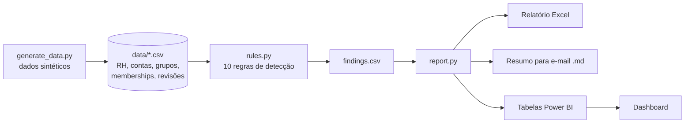

# IAM Access Review Automation

[](https://github.com/mateus-macciel/iam-access-review/actions/workflows/ci.yml)


Automação em Python para **revisão de acessos (IAM)**: lê exportações no estilo Active Directory + RH,
aplica 10 regras de detecção (contas órfãs, conflitos de segregação de funções, privilégios excessivos,
revisões atrasadas, etc.) e gera um relatório em Excel, um resumo pronto para e-mail e as tabelas para um
dashboard em Power BI.

> **Todos os dados são sintéticos (fictícios).** Este projeto não usa dados, código ou configuração de
> nenhuma empresa. Os dados são gerados por `src/generate_data.py`, com anomalias plantadas de propósito
> para que as regras e o dashboard tenham o que mostrar.

## O problema

Revisar acessos manualmente é lento e propenso a erro: planilhas exportadas de vários sistemas, cruzamento
com a lista do RH, cobrança de gestores. O resultado costuma ser contas de ex-colaboradores ativas,
acessos privilegiados sem revisão e conflitos de função que passam despercebidos.

## O que o projeto faz



### Regras de detecção

| ID | Regra | Severidade | O que procura |
|---|---|---|---|
| R01 | `orphan_account` | high / critical | Conta ativa de pessoa desligada (critical se houve logon após o desligamento) ou sem vínculo no RH |
| R02 | `dormant_account` | medium / high | Conta ativa sem logon há mais de 90 dias (high se tiver acesso privilegiado) |
| R03 | `sod_conflict` | high / critical | Mesma conta com grupos conflitantes (ex.: iniciar e aprovar pagamento) |
| R04 | `cross_department_privilege` | high | Acesso privilegiado a grupo cujo dono é outra área |
| R05 | `excessive_privileged_groups` | medium / high | Conta em 3 ou mais grupos privilegiados |
| R06 | `unreviewed_privileged_access` | medium / high | Acesso privilegiado sem revisão concluída nos últimos 180 dias |
| R07 | `revoked_not_removed` | high | A revisão decidiu revogar, mas o acesso continua |
| R08 | `overdue_review` | low / medium | Revisão pendente além do prazo |
| R09 | `late_deprovisioning` | low / medium | Conta desativada depois do SLA após o desligamento |
| R10 | `service_account_without_owner` | medium / high | Conta de serviço sem responsável (owner) |

Detalhes, justificativa e referências (ISO 27001, NIST CSF 2.0, CIS Controls) em [`docs/rules.md`](docs/rules.md).

## Como rodar

Requisitos: Python 3.10+ (testado com Python 3.12 e pandas 3).

```bash
git clone https://github.com/mateus-macciel/iam-access-review.git
cd iam-access-review

python -m venv .venv
source .venv/bin/activate        # Windows: .venv\Scripts\activate
pip install -r requirements.txt

# 1) gerar os dados sintéticos (reprodutível: mesma seed, mesmos dados)
python src/generate_data.py --employees 400 --seed 42 --ref-date 2026-11-13

# 2) rodar a revisão
python src/run_review.py

# 3) testes
python -m unittest discover -s tests -v
```

Parâmetros de política (todos opcionais): `--dormant-days 90`, `--review-window-days 180`,
`--privileged-threshold 3`, `--deprovision-sla-days 2`.

Com `make`: `make demo` (dados + revisão) e `make test`.

## Saídas

| Arquivo | Para quê |
|---|---|
| `output/access_review_report.xlsx` | Relatório com resumo (fórmulas), achados filtráveis, top contas e revisões pendentes. As colunas Responsável/Status/Observações permitem acompanhar a remediação |
| `output/summary.md` | Texto pronto para enviar por e-mail ao time/gestor |
| `output/findings.csv` | Todos os achados em formato tabular |
| `output/powerbi/*.csv` | Tabelas dimensão e fato para o dashboard |

Exemplos gerados com a seed padrão estão em [`examples/`](examples/).

### Exemplo de resultado (seed 42, 400 registros de RH)

102 achados em 78 contas (20,6% das contas ativas): 7 critical, 42 high, 38 medium, 15 low.
Cobertura de revisão dos acessos privilegiados: 92,0%. Revisões vencidas: 33.

## Dashboard (Power BI)

Modelo de dados, medidas DAX e layout das páginas em [`docs/powerbi.md`](docs/powerbi.md).

[Visão geral](docs/img/visao-geral.png)


## Decisões de design

- **Regras como funções puras** (`DataFrame in → DataFrame out`): fáceis de testar e de estender.
- **Política centralizada** em `src/policy.py` (severidades, níveis privilegiados, conflitos SoD), usada
  pelo gerador e pelas regras, para que os dois nunca divirjam.
- **Dados sintéticos reprodutíveis** (seed + data de referência), com anomalias plantadas e contagens
  conhecidas, o que permite testar de ponta a ponta.
- **Evita dupla contagem:** conta já marcada como órfã (R01) não gera também R06, porque a correção é
  desativar a conta.
- **Excel com fórmulas** (`COUNTIFS`, `SUMIFS`): quando o time muda o Status de um achado, os totais do
  resumo recalculam.

## Limitações e próximos passos

- Os dados são sintéticos e simplificados; um ambiente real tem mais atributos e ruído.
- Não há histórico de movimentações internas (mover de área mantendo os acessos antigos).
- Contas administrativas separadas das contas comuns (boa prática) ainda não são modeladas.
- Próximos passos: leitura direta de exportações reais (LDAP/Entra ID via API), envio automático do
  resumo, regra de "acesso sem uso" (último uso por grupo) e dashboard publicado.

## Estrutura

```
iam-access-review/
├── src/
│   ├── policy.py          # severidades, níveis privilegiados, conflitos SoD
│   ├── generate_data.py   # gerador de dados sintéticos
│   ├── rules.py           # regras R01-R10
│   ├── report.py          # Excel, resumo .md e exportação Power BI
│   └── run_review.py      # CLI
├── data/                  # dados sintéticos (CSV)
├── tests/                 # testes unitários e de ponta a ponta
├── docs/                  # regras e guia do dashboard
├── examples/              # exemplos de saída
└── .github/workflows/     # CI
```

## Licença

MIT. Veja [`LICENSE`](LICENSE).

---

## English summary

Python automation for **identity and access management (IAM) access reviews**. It reads AD-like and HR
exports, applies 10 detection rules (orphan and dormant accounts, segregation-of-duties conflicts,
privilege creep, unreviewed or overdue reviews, late offboarding, ownerless service accounts) and produces
an Excel report, an e-mail-ready summary and Power BI-ready tables.

**All data is synthetic**: generated by `src/generate_data.py` with planted anomalies, fully reproducible
via `--seed` and `--ref-date`. No real company data or code is used. Quick start:

```bash
pip install -r requirements.txt
python src/generate_data.py --employees 400 --seed 42 --ref-date 2026-11-13
python src/run_review.py
python -m unittest discover -s tests -v
```
